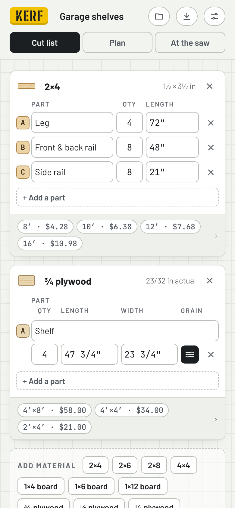
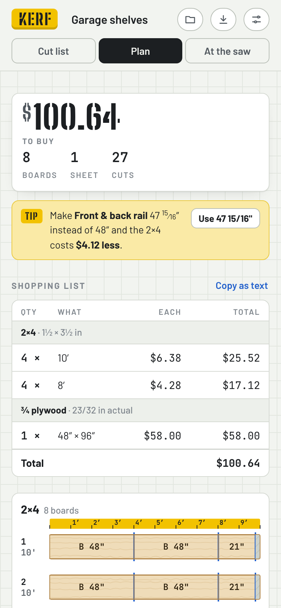
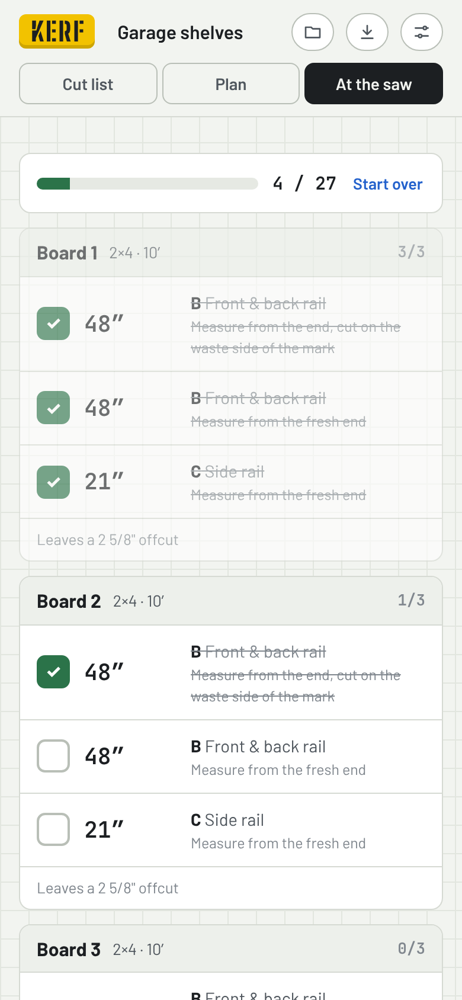

# Kerf

**Use it: [kerf.junkdrawer.works](https://kerf.junkdrawer.works/)**

**A cut-list optimizer for lumber and plywood.** List the parts a project needs; Kerf works out the cheapest boards and sheets to buy, draws how to cut each one, and gives you a checklist to work through at the saw. It installs as an app (from the browser's menu, or Share → Add to Home Screen on an iPhone) and works offline once it has loaded.

<p align="center">
  
  &nbsp;
  
  &nbsp;
  
</p>

## How it works

- **Cut list.** Group parts by material: 2×4s, 1×6s, ¾ plywood, anything. Each material lists the sizes you can buy and what they cost. Lengths can be typed the way a tape reads: `35 3/4`, `35-3/4`, `2' 11 3/4"`, `¾`, or `910mm`. The page can also work in millimetres throughout.
- **Plan.** The total to spend, a shopping list you can copy as text, and a diagram of every board and sheet. The diagrams show the parts, the saw kerf between them, and the offcut left over.
- **Tips.** After each change Kerf checks whether shaving a part by a sixteenth or two (or a few mm) would let you buy less wood. It says so — *“Make the rail 47 15/16″ instead of 48″ and the 2×4s cost $4.12 less”* — with a button to apply it.
- **Offcuts you already have** are used first, for free, and never more of them than you say you have.
- **Grain.** Sheet parts can be locked so the grain runs along their length; unlocked parts may be turned to fit better.
- **At the saw.** Each board and sheet becomes a checklist in cutting order, with where to measure from. Ticks are saved as you go.
- **Shop PDF.** A printable sheet with the shopping list and every diagram.
- **Projects** are kept in the browser's local storage, with no account and no server. To move one to another device, save it as a file or copy it as text, then open or paste it there.

Settings per project: saw kerf (⅛″ by default), trimming each board end square, the smallest offcut worth keeping, and the currency sign. The preset prices are examples; change them to what your store charges.

## How it plans

**Boards** are a cutting-stock problem: fit pieces onto stock lengths as cheaply as possible, with a kerf between pieces.

1. Kerf first tries an exact search. Some board must hold the longest piece left, and it can take every other piece that still fits: moving a piece onto it from another board never costs more. So Kerf branches only on those boards, remembering the cheapest way to finish from each set of pieces left. For the cut lists people actually make — a handful of distinct lengths — this finishes in milliseconds and the answer is the cheapest possible.
2. When a job is too big for that search, Kerf falls back to heuristics:
   - a greedy fill by price per inch of parts;
   - a look-ahead that tries every first board and finishes greedily;
   - randomized restarts.
3. Each board then moves to the cheapest stock length its pieces still fit on.

**Sheets** are cut with guillotine cuts only — every cut runs edge to edge across the piece, which is what a table saw or track saw can do. Kerf packs parts into free rectangles and tries:

- several part orders, fit rules and split rules;
- shuffled orders;
- repacking each sheet's parts onto smaller sheet sizes when that costs less (two half sheets can beat one full one).

The layout's cut tree becomes the numbered rip and crosscut steps. Sheet packing is a heuristic, not a proof: it is good, not guaranteed optimal.

Every search stops after a set number of steps, not after a set time, so a project gets the same plan on a fast laptop and a slow phone, and the ticks at the saw stay put.

## Planning a build with Claude

`skill/kerf-planner/` is a skill for Claude. It helps you work out a design in conversation, derives an exact cut list from actual lumber sizes and the joinery, and hands the result to Kerf as a link and a project file. To use it, zip the `kerf-planner` folder and upload it as a skill in claude.ai; it needs code execution turned on. Its script, `scripts/make_kerf.py`, also runs on its own:

```
python3 skill/kerf-planner/scripts/make_kerf.py plan.json
```

## Opening a project from a link

A link like `https://kerf.junkdrawer.works/#k1z…` carries a whole project in the part after `#`, so it never reaches a server. Opening one shows what's in it and asks before adding it as a new project. It never replaces one you have, and a link opened twice offers your existing copy.

The format is the project JSON, compressed with raw DEFLATE and base64url-encoded; `#k1j…` is the same without compression. `#project=` followed by URL-encoded JSON also works, for writing a link by hand.

## Project files

A saved project is JSON: `{"kerf": 1, "project": {…}}`. Lengths are stored in inches whatever the display units. Opening a file keeps only fields Kerf understands and clamps the numbers, so a hand-edited file can't break the page.

## Running it

It's a static site: plain HTML, CSS and JavaScript in one page, with no build step.

```sh
npx serve .                   # or any static file server, then open the printed address
npm test                      # checks the solver against brute force, then uses the real page in Chromium (needs Playwright)
node tools/screenshots.mjs    # redraws docs/*.png and og.png
node tools/make-icons.mjs     # redraws the PNG icons from icon.svg
```

To put it online with GitHub Pages: **Settings → Pages → Build and deployment → Deploy from a branch**, then pick `main` and `/ (root)`.

### Tests

`npm test` runs two suites. `test/solver.test.cjs` needs no dependencies: it reads the solver straight out of `index.html` and checks:

- **Parsing:** lengths in each format parse to the right value.
- **Boards:** the example project costs the known optimum, and several hundred random jobs match a brute-force search. The random jobs include offcuts on hand, end trim and two kerf widths. Boards on hand that run short are reported, not left to crash.
- **Big jobs:** a 90-piece job finishes quickly, and 800 pieces in 16 lengths don't run the search out of stack.
- **Sheets:** in 200 random jobs, every part is on its sheet at the right size, no two parts overlap once the kerf is counted, and grain-locked parts are never turned.
- **Same plan anywhere:** with the clock slowed to a crawl, the example, a bigger board job and a plywood cabinet come out exactly as they do at full speed.

`test/e2e.mjs` uses the real page in Chromium at phone size (it needs Playwright). It opens the example and checks its total, opens a link and a project file made by the kerf-planner skill (and broken links), ticks cuts at the saw and reloads, checks the steps for boards that need a last cut or end trim, the plan's warnings and drawings, the shop PDF's layout, tips, the dialogs from the keyboard, and when Kerf saves. Throughout, nothing may scroll sideways, throw an error or load from elsewhere, and at the end it opens offline.

### Files

- `index.html`: the whole app: the cut list, the board and sheet solvers, the drawings, the checklist for the saw and the shop PDF.
- `fonts/`: Barlow, Big Shoulders Stencil and JetBrains Mono (SIL Open Font License), served from here so nothing loads from elsewhere.
- `sw.js`: keeps a copy for using offline.
- `manifest.webmanifest`, `icon.svg` and `icon-*.png`: let it install to a phone's home screen.
- `og.png`: the link preview.
- `CNAME` and `carry.js`: Kerf moved from junkdrawer.works/kerf/ to its own address. `CNAME` gives it kerf.junkdrawer.works, and `carry.js` brings the projects saved at the old address over the first time it opens at the new one.
- `skill/kerf-planner/`: the skill for Claude, above.
- `tools/`: `screenshots.mjs` for the pictures; `make-icons.mjs` and `icon-full-bleed.svg` for the icons.
- `test/`: `solver.test.cjs` and `e2e.mjs`.

## License

MIT — see [LICENSE](LICENSE).
